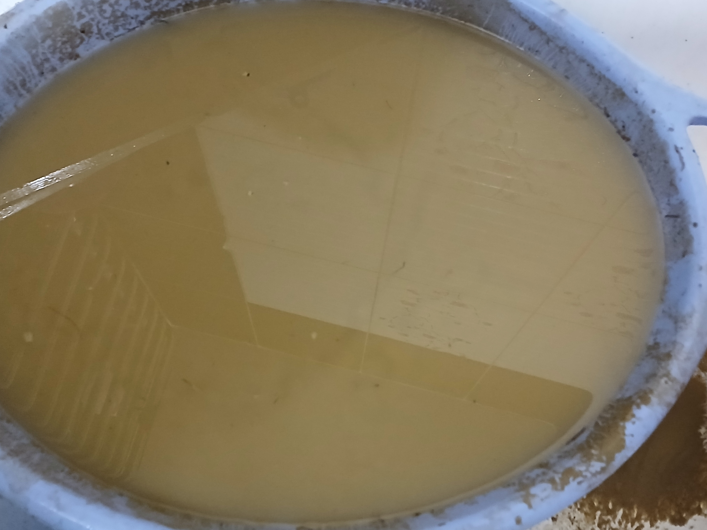
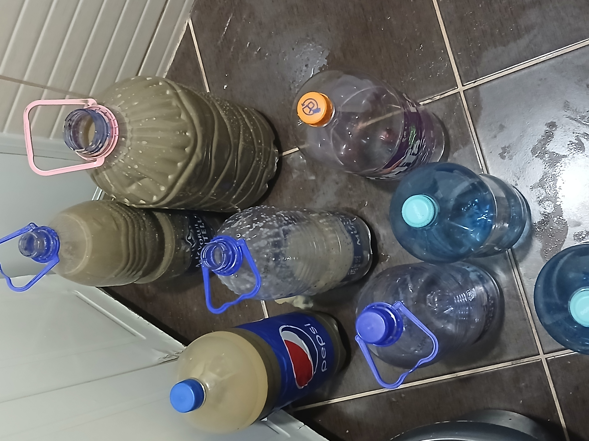
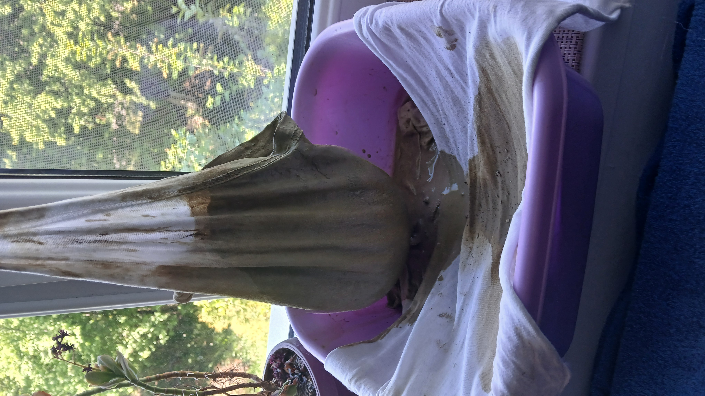
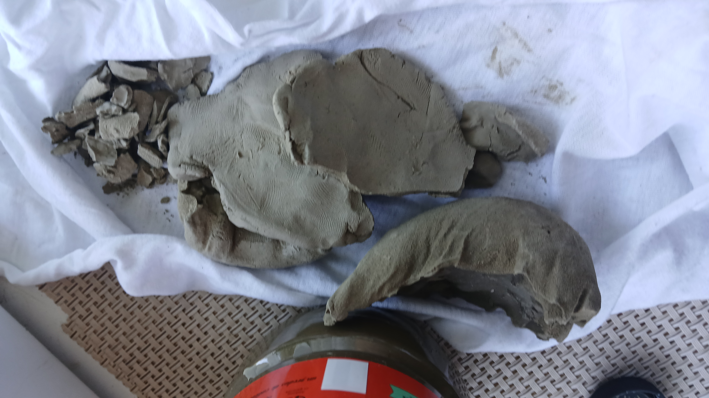
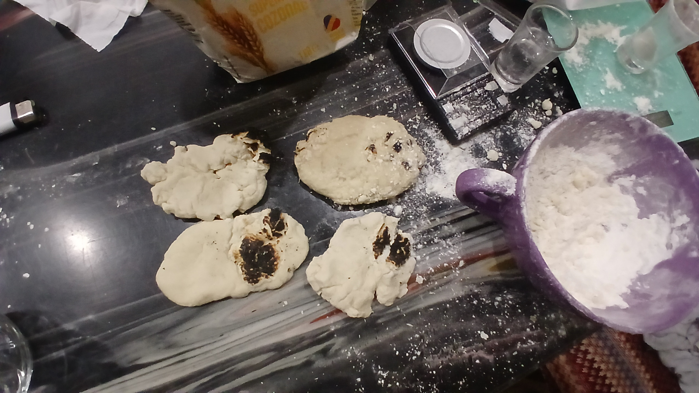
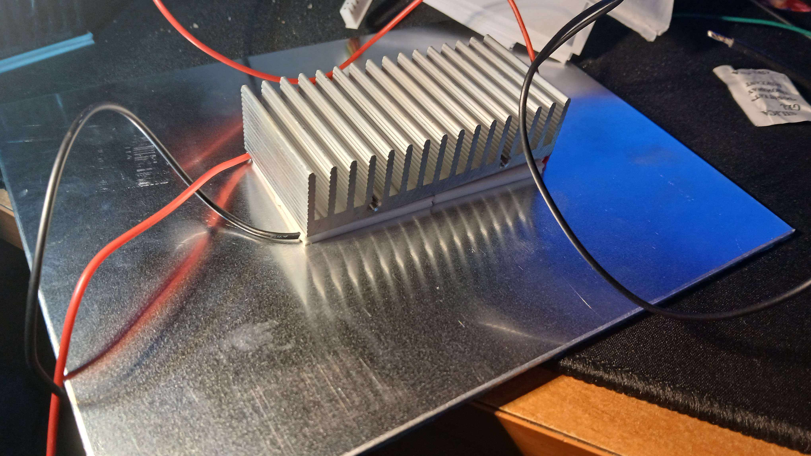
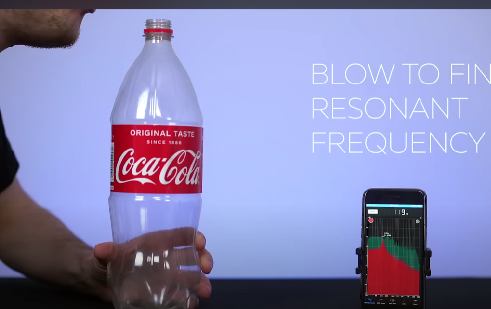

# Other Projects and Ideas

## Description:
This repository contains some projects and ideas witch worth your attention.
Every week this page get`s updated with new discovered stuff.

## News:
This news section will be updated weekly after 17/8/2024.
For now you have 5 mentions and 4 projects to look into.

## Mentions:
- [controll OLED dirrectly to HDMI](https://mitxela.com/projects/ddc-oled)
- [This is a painless guitar](https://www.youtube.com/watch?v=Pv8xAU__Ye0&list=WL&index=181)
- [Custom file extension](https://www.youtube.com/watch?v=_FvmTFsDZ84&list=PLOSOqCeZCHL0Qxb6YyrvGzjCg9FLfzHYJ&index=19)
- [TIC TAC TOE](https://www.youtube.com/watch?v=On_4U0aeKG4&list=WL&index=64)
- [ELEVATOR](https://www.youtube.com/watch?v=3RKgASpq2P4&list=PLOSOqCeZCHL0Qxb6YyrvGzjCg9FLfzHYJ&index=72)
- [Segment displays](https://youtu.be/B887D3PVYqs?si=KS5QnkuYI9ruFV4f)

## Projects:

 

Sonoluminescence 

[Sonoluminescence](https://en.wikipedia.org/wiki/Sonoluminescence) is a process in witch you can \"transform\" sound into ligth. 
It works by creating a fast colapsing air buble in the water witch, because of the verry high pressure can reach almost 12000 celsius degrees and produce ligth.
With this, you can make a \"star in a jar\" like [this](https://www.youtube.com/watch?v=puVxGnl_3y8) guy, or like [this](https://www.youtube.com/watch?v=0TVZd8dZysY&list=WL&index=284) guy. Other way "conserving" power is heating rare gases with electrons like [this](https://www.youtube.com/watch?v=VTBZ0VwIgs8&list=PLOSOqCeZCHL0Qxb6YyrvGzjCg9FLfzHYJ&index=119).
You can read more in this papers:
- http://techmind.org/sl/
- https://pubs.aip.org/asa/jasa/article/138/4/2181/899097/Resource-Paper-Sonoluminescence

 

Capacitive touch 

Here are some examples of what it is and how it works:
- https://www.youtube.com/watch?v=DxWZUTnEvhs
- https://www.youtube.com/watch?v=FjcVGP6vktM
- https://www.youtube.com/watch?v=X7U_6wZqxro
- https://www.youtube.com/watch?v=gxLzgeiJQbE
- https://www.youtube.com/watch?v=mWR9Q_pTagw
- https://www.youtube.com/watch?v=3xUH_vCHk9A
- https://www.youtube.com/watch?v=FjcVGP6vktM&list=PLOSOqCeZCHL0Qxb6YyrvGzjCg9FLfzHYJ&index=195

 

Start a Pottery Journei /   Make Clay 

If you don`t want to pay for \"[magic dirt](https://www.youtube.com/watch?v=ca20JkKFAcE)\",  make it yourself.
Go in the forest or other dirty places and search for sticky soil (look for tire marks, yellow color soil, mud, ...). Filter it until you remain with particles smaller than 2um, add some more [ingredients](https://www.youtube.com/watch?v=HbLdNKM9y68&list=WL&index=125) and start making vases and other kinks of yours.  
Have fun and [reuse](https://www.youtube.com/shorts/1bMbADiztPY). 

<table>
  <tr>
    <td></td>
    <td></td>
    <td></td> 
  </tr>
</table>
<table>
  <tr>
    <td></td>
    <td></td>  
    <td></td>
    <td></td> 
    <td></td>  
    <td></td>     
  </tr>
</table>

 

Osmosis

If you separate in a container, pure water(H2O) and /"salty/" water with a membrane with holes big enouch that only water molecules can pass truth it, the pure water will flow to the /"salty/" water [video1](https://www.youtube.com/watch?v=4RDA_B_dRQ0&list=PLOSOqCeZCHL0Qxb6YyrvGzjCg9FLfzHYJ&index=259), [video2](https://www.youtube.com/watch?v=vCJVXYmXkzM&list=PLOSOqCeZCHL0Qxb6YyrvGzjCg9FLfzHYJ&index=252&t=174s). This process is called <b>osmosis</b>. By presurasing the /"salty/" water, you can push it trouth the filter, so only the water molecules to go trouth the filter, making pure water. This process named <b>reverse osmosis</b> is used in city water purrifiers. By combining the pure water with some esential minerals, you can make the water potable. Pure water in big quantities is [poisonous](https://www.youtube.com/watch?v=L-osEc07vMs&list=PLOSOqCeZCHL0Qxb6YyrvGzjCg9FLfzHYJ&index=251)

 

Starlyte

<table>
  <tr>
    <td> 

  Starlyte is a verry heat ressistent matherial witch can be mad with household ingredients.
  I tried making it, but it [didn/`t worked well](https://github.com/Tonikiller10000/Other-Projects-and-Ideas/blob/main/ProjectsAndIdeeas/Starlyte/3.mp4) at all. May be my recipe a little wrong, but after 30 mins of plaing arround with it, I [couldn\`t make it work](https://github.com/Tonikiller10000/Other-Projects-and-Ideas/blob/main/ProjectsAndIdeeas/Starlyte/2.mp4).
  I may try it again in the far future.
    </td>
    <td></td>
  </tr>
</table>

 

Icecream Plate

I tried to make [this](https://youtu.be/LPOWmK9EWk0?si=V09L9m4uheya51iG) Icecream plate with some peltier plates, but unfortunetly that didn\`t work. It was cooling too slow, and to little.
I even used 2 peltier plates with thermal paste between and a computer heatsing with fan connected, but it [didn\`t worked](https://github.com/Tonikiller10000/Other-Projects-and-Ideas/blob/main/ProjectsAndIdeeas/PeltierPlate_IceCreamMachine/f.mp4). I will try it again in the future with a mechanical method of cooling (compressor).
<table>
  <tr>
    <td></td>
    <td></td> 
    <td></td>
  </tr>
</table>

 

Cool phisiscs toys

The first one is a "perpetual motion" device from Iron Man 2 movie witch is named "swinging sticks" and looks verry cool to have on the desk.
The second one is a "Newtons`s Cradle" and is also cool to have on a shelf.
The third one are 2 armonic forks witch resonate at the same frequency, and becouse of that, by hitting the first one to start resonating, the second one will start too.
The forth one is a "propulsion device" witch works by moving the air inside and out of the bottles when they are vibrating at the resonat frequency.
The fifth one, also demonstrates the resonant frequency by generating it with the phone and making the bottle vigrate.
Forth and fifth are not good decoratives, but are preety cool phisics experiments.
<table>
  <tr>
    <td></td>
    <td></td>
    <td></td>
    <td></td>
    <td></td>
  </tr>
</table>

 
 
 
 
 
 
 
 

## ///////////////// in construction ///////////////////

 

wireless power transfer 

Wireless power transmission is a verry interesting topic on witch you can find more in the videos or papers linked under. 

Wireless power transfer papers & videos:
- [GreatScott video 1](https://www.youtube.com/watch?v=15HmW1K8MZY)
- [GreatScott video 2](https://www.youtube.com/watch?v=S3mLHpzzcTU&t=523s)
- https://www.youtube.com/watch?v=hZ8PqQWyUR8
- https://www.nature.com/articles/s41598-021-03570-8
- https://www.st.com/content/dam/technology-tour-2017/session-3_track-7_wireless-charging.pdf
- https://www.circuitbasics.com/what-is-an-inductor/
- https://physics.info/inductance/
- https://courses.lumenlearning.com/suny-physics/chapter/23-9-inductance/
- https://www.youtube.com/watch?v=jdc_0r5pJPc&list=PLOSOqCeZCHL0Qxb6YyrvGzjCg9FLfzHYJ&index=236

Hardware design:
- https://www.ti.com/lit/an/sluaaj6/sluaaj6.pdf?ts=1717714815041&ref_url=https%253A%252F%252Fwww.google.com%252F
- https://www.pchintl.com/wp-content/uploads/2021/04/PCH-Wireless-Charging-Device.pdf
- https://www.researchgate.net/figure/Circuit-diagram-and-working-mechanism-of-wireless-charging-system-a-Circuit-diagram-of_fig4_346339798
- https://www.circuits-diy.com/wireless-gadgets-charger-circuit/
- https://www.nutsvolts.com/magazine/article/august2013_Bates
- https://www.circuits-diy.com/wireless-cellphone-battery-charger-circuit/
- https://www.circuits-diy.com/wireless-gadgets-charger-circuit/
- https://www.homemade-circuits.com/high-current-wireless-battery-charger/
- https://electronoobs.com/eng_circuitos_tut58_sch2.php#google_vignette
- https://electronoobs.com/eng_circuitos_tut58_sch1.php

 

Jet Engine

If you want to make a [Jet Engine](https://www.youtube.com/watch?v=Is3HRNNZxc8&list=PLOSOqCeZCHL0Qxb6YyrvGzjCg9FLfzHYJ&index=48), this is the [channel](https://www.youtube.com/@integza) that you are looking for.

 

Nanotechnology

If you want to make advanced stuff, you need to work smaller. Here are some links of what smaller means, how to make smaller electronics, and how to do nonoscopic fibers.
Nanotech:
- https://www.youtube.com/watch?v=6ZbGmXfEnd0&list=WL&index=206
- https://www.youtube.com/watch?v=ub88I0bR9ho&list=PLOSOqCeZCHL0Qxb6YyrvGzjCg9FLfzHYJ&index=310&t=446s
- https://www.youtube.com/watch?v=9t1SDA2Jqak&list=PLOSOqCeZCHL0Qxb6YyrvGzjCg9FLfzHYJ&index=311&t=245s
- https://www.youtube.com/watch?v=OLa8DQkKlyU&list=PLOSOqCeZCHL0Qxb6YyrvGzjCg9FLfzHYJ&index=313&t=319s
- https://www.youtube.com/watch?v=Mr7IEvlflnI&list=PLOSOqCeZCHL0Qxb6YyrvGzjCg9FLfzHYJ&index=315
- https://www.youtube.com/watch?v=pcCfcYqcZgs&list=PLOSOqCeZCHL0Qxb6YyrvGzjCg9FLfzHYJ&index=315
- https://www.youtube.com/watch?v=N7lXymxsdhw&list=PLOSOqCeZCHL0Qxb6YyrvGzjCg9FLfzHYJ&index=316
- https://www.youtube.com/watch?v=onanaCRu9ss&list=PLOSOqCeZCHL0Qxb6YyrvGzjCg9FLfzHYJ&index=124
- https://www.youtube.com/watch?v=2TjdGuBK9mI&list=PLOSOqCeZCHL0Qxb6YyrvGzjCg9FLfzHYJ&index=253
- https://www.youtube.com/watch?v=-QxioOUyFLg&list=PLOSOqCeZCHL0Qxb6YyrvGzjCg9FLfzHYJ&index=204

Lithography1:
- https://www.youtube.com/watch?v=emUoFq5nRZM&list=PLOSOqCeZCHL0Qxb6YyrvGzjCg9FLfzHYJ&index=41
- https://www.youtube.com/watch?v=RI3lCUEzSvE&list=PLOSOqCeZCHL0Qxb6YyrvGzjCg9FLfzHYJ&index=42
- https://www.youtube.com/watch?v=m2WuoODe56U&list=PLOSOqCeZCHL0Qxb6YyrvGzjCg9FLfzHYJ&index=43
- https://www.youtube.com/watch?v=nkwJPIJJ3hM&list=PLOSOqCeZCHL0Qxb6YyrvGzjCg9FLfzHYJ&index=44&t=583s
- https://www.youtube.com/watch?v=5f2xOxRGKqk&list=PLOSOqCeZCHL0Qxb6YyrvGzjCg9FLfzHYJ&index=58&t=1s
- https://www.youtube.com/watch?v=f7KKd292WMQ&list=PLOSOqCeZCHL0Qxb6YyrvGzjCg9FLfzHYJ&index=254
- https://www.youtube.com/watch?v=RiRyap-EVg0&list=PLOSOqCeZCHL0Qxb6YyrvGzjCg9FLfzHYJ&index=255
- https://www.youtube.com/watch?v=8yyXLHKGVro&list=PLOSOqCeZCHL0Qxb6YyrvGzjCg9FLfzHYJ&index=256
- https://www.youtube.com/watch?v=BfZfqMDERQM&list=PLOSOqCeZCHL0Qxb6YyrvGzjCg9FLfzHYJ&index=257

Electrospinning:
- https://www.youtube.com/watch?v=KVG7ex7gnD8&list=PLOSOqCeZCHL0Qxb6YyrvGzjCg9FLfzHYJ&index=35
- https://www.youtube.com/watch?v=i9zPeMOpYGQ&list=PLOSOqCeZCHL0Qxb6YyrvGzjCg9FLfzHYJ&index=150&t=603s
- https://www.youtube.com/watch?v=zS7vM9xm8m8&list=PLOSOqCeZCHL0Qxb6YyrvGzjCg9FLfzHYJ&index=152
- https://www.youtube.com/watch?v=ZZ9iExn5VtI&list=PLOSOqCeZCHL0Qxb6YyrvGzjCg9FLfzHYJ&index=153
- https://www.youtube.com/watch?v=xT1gYZGDx4I&list=WL&index=133

- https://www.youtube.com/watch?v=9TYlQ4urcg8&list=PLOSOqCeZCHL0Qxb6YyrvGzjCg9FLfzHYJ&index=195
- https://www.youtube.com/watch?v=O4pVny7NV8E&list=PLOSOqCeZCHL0Qxb6YyrvGzjCg9FLfzHYJ&index=188

 

If you want to make some speakers, this is how to make the enclosure. 

Speaker enclosure links:
- https://www.youtube.com/watch?v=Df2I4JIQzxs
- https://www.youtube.com/watch?v=xT1gYZGDx4I&list=PLOSOqCeZCHL0Qxb6YyrvGzjCg9FLfzHYJ&index=13
- https://www.youtube.com/watch?v=pUgxjNrwvOE&list=PLOSOqCeZCHL0Qxb6YyrvGzjCg9FLfzHYJ&index=57&t=1s
- https://www.youtube.com/watch?v=GrrxGm18KSY&list=WL&index=127
- https://www.youtube.com/watch?v=pUgxjNrwvOE&list=WL&index=130
- https://www.youtube.com/watch?v=XEspOD1NHr0&list=PLOSOqCeZCHL0Qxb6YyrvGzjCg9FLfzHYJ&index=217

 

Oxytorch

You can make an oxytorch by separring hydrogen and oxygen with electrolisis, and burning it at an higher pressure

Oxytorch:
- https://www.youtube.com/watch?v=d85OX6yEwE0&list=PLOSOqCeZCHL0Qxb6YyrvGzjCg9FLfzHYJ&index=15
- https://www.youtube.com/watch?v=7M4yqcO_pPo&list=PLOSOqCeZCHL0Qxb6YyrvGzjCg9FLfzHYJ&index=129&t=23s

 

Homemade bearings

Homemade bearings:
- https://www.youtube.com/watch?v=eT8oQvHjzXE&list=PLOSOqCeZCHL0Qxb6YyrvGzjCg9FLfzHYJ&index=36
- https://www.youtube.com/watch?v=HboIscftCL8&list=PLOSOqCeZCHL0Qxb6YyrvGzjCg9FLfzHYJ&index=37
- https://www.youtube.com/watch?v=5Dkruh8NO9E&list=PLOSOqCeZCHL0Qxb6YyrvGzjCg9FLfzHYJ&index=38
- https://www.youtube.com/watch?v=8V8MH2k8Igs&list=PLOSOqCeZCHL0Qxb6YyrvGzjCg9FLfzHYJ&index=39
- https://www.youtube.com/watch?v=6hcl3mgk2tc&list=PLOSOqCeZCHL0Qxb6YyrvGzjCg9FLfzHYJ&index=40
- https://www.youtube.com/watch?v=fdvRFE680u0&list=PLOSOqCeZCHL0Qxb6YyrvGzjCg9FLfzHYJ&index=41
- https://www.youtube.com/watch?v=xg_iOEb2M00&list=PLOSOqCeZCHL0Qxb6YyrvGzjCg9FLfzHYJ&index=25&t=8s
- https://www.youtube.com/watch?v=_MIx_vN2Dtk&list=PLOSOqCeZCHL0Qxb6YyrvGzjCg9FLfzHYJ&index=26
- https://www.youtube.com/watch?v=UIhCPl8eb7s&list=PLOSOqCeZCHL0Qxb6YyrvGzjCg9FLfzHYJ&index=27
- https://www.youtube.com/watch?v=5YIZaJnER_k&list=PLOSOqCeZCHL0Qxb6YyrvGzjCg9FLfzHYJ&index=143
- https://www.youtube.com/watch?v=nRrHrB6gaoE&list=PLOSOqCeZCHL0Qxb6YyrvGzjCg9FLfzHYJ&index=112

 

Satelite

Satelite: 
- https://www.youtube.com/watch?v=AK04FVMZ6pI&list=PLOSOqCeZCHL0Qxb6YyrvGzjCg9FLfzHYJ&index=123
- https://www.youtube.com/watch?v=5voQfQOTem8&list=PLOSOqCeZCHL0Qxb6YyrvGzjCg9FLfzHYJ&index=161
- https://www.youtube.com/watch?v=1I3dKEriVl8&list=WL&index=86
- https://www.youtube.com/watch?v=30XpSozOZII&list=PLOSOqCeZCHL0Qxb6YyrvGzjCg9FLfzHYJ&index=21
- https://www.youtube.com/watch?v=wuB3NeIp6CM&list=PLOSOqCeZCHL0Qxb6YyrvGzjCg9FLfzHYJ&index=29&t=148s

 

Coil Gun

Coil Gun:
- https://www.youtube.com/watch?v=Xll9rIzZPeQ&list=PLOSOqCeZCHL0Qxb6YyrvGzjCg9FLfzHYJ&index=90
- https://www.youtube.com/watch?v=s161wEcIfGM&list=PLOSOqCeZCHL0Qxb6YyrvGzjCg9FLfzHYJ&index=158
- https://www.youtube.com/watch?v=KikIp_yAXvQ&list=PLOSOqCeZCHL0Qxb6YyrvGzjCg9FLfzHYJ&index=160
- https://www.youtube.com/watch?v=MXLzC7Jo4hA&list=PLOSOqCeZCHL0Qxb6YyrvGzjCg9FLfzHYJ&index=161
- https://www.youtube.com/watch?v=ReFUr3KuK40&list=PLOSOqCeZCHL0Qxb6YyrvGzjCg9FLfzHYJ&index=162
- https://www.youtube.com/watch?v=_hRNFN5Hxzo&list=PLOSOqCeZCHL0Qxb6YyrvGzjCg9FLfzHYJ&index=163&t=1s
- https://www.youtube.com/watch?v=TWeJsaCiGQ0&list=PLOSOqCeZCHL0Qxb6YyrvGzjCg9FLfzHYJ&index=164&t=46s
- https://www.youtube.com/watch?v=Zm_oZZZBLj8&list=PLOSOqCeZCHL0Qxb6YyrvGzjCg9FLfzHYJ&index=165
- https://www.youtube.com/watch?v=qXXYkxCSiUY&list=PLOSOqCeZCHL0Qxb6YyrvGzjCg9FLfzHYJ&index=166&t=870s
- https://www.youtube.com/watch?v=r8YHxpa5cJA&list=PLOSOqCeZCHL0Qxb6YyrvGzjCg9FLfzHYJ&index=167&t=337s
- https://www.youtube.com/watch?v=2B2ZEN2Qu-Q&list=PLOSOqCeZCHL0Qxb6YyrvGzjCg9FLfzHYJ&index=168
- https://www.youtube.com/watch?v=JqCHuwemHYU&list=PLOSOqCeZCHL0Qxb6YyrvGzjCg9FLfzHYJ&index=169
- https://www.youtube.com/watch?v=OdKDb0fnAb0&list=PLOSOqCeZCHL0Qxb6YyrvGzjCg9FLfzHYJ&index=170&t=125s
- https://www.youtube.com/watch?v=pFFZcaWAxLg&list=PLOSOqCeZCHL0Qxb6YyrvGzjCg9FLfzHYJ&index=171
- https://www.youtube.com/watch?v=9Z2_KcByZvM&list=PLOSOqCeZCHL0Qxb6YyrvGzjCg9FLfzHYJ&index=172
- https://www.youtube.com/watch?v=_4TGb3MsSjE&list=PLOSOqCeZCHL0Qxb6YyrvGzjCg9FLfzHYJ&index=173&t=318s
- https://www.youtube.com/watch?v=UWqMRJZEqRA&list=PLOSOqCeZCHL0Qxb6YyrvGzjCg9FLfzHYJ&index=174
- https://www.youtube.com/watch?v=vtoWxGVx5kA&list=PLOSOqCeZCHL0Qxb6YyrvGzjCg9FLfzHYJ&index=175
- https://www.youtube.com/watch?v=id90kjYh-Qw&list=PLOSOqCeZCHL0Qxb6YyrvGzjCg9FLfzHYJ&index=176&t=247s
- https://www.youtube.com/watch?v=PMU9TQUDhow&list=PLOSOqCeZCHL0Qxb6YyrvGzjCg9FLfzHYJ&index=177
- https://www.youtube.com/watch?v=QTDcFxTq1Fw&list=PLOSOqCeZCHL0Qxb6YyrvGzjCg9FLfzHYJ&index=178&t=1162s

 

Metal detector

Metal detection:
- https://www.youtube.com/watch?v=EcuTsifSgBs&list=PLOSOqCeZCHL0Qxb6YyrvGzjCg9FLfzHYJ&index=80
- https://www.youtube.com/watch?v=df8jFglzkNg&list=PLOSOqCeZCHL0Qxb6YyrvGzjCg9FLfzHYJ&index=81
- https://www.youtube.com/watch?v=WQjbAzRL6RQ&list=PLOSOqCeZCHL0Qxb6YyrvGzjCg9FLfzHYJ&index=82
- https://www.youtube.com/watch?v=7QJrI-9CCIw&list=PLOSOqCeZCHL0Qxb6YyrvGzjCg9FLfzHYJ&index=83
- https://www.youtube.com/watch?v=FmmYviJ45bM&list=PLOSOqCeZCHL0Qxb6YyrvGzjCg9FLfzHYJ&index=84&t=6s
- https://www.youtube.com/watch?v=yzrVHEB02Hw&list=PLOSOqCeZCHL0Qxb6YyrvGzjCg9FLfzHYJ&index=85

 

Centrifuge

Centrifuge:
- https://www.youtube.com/watch?v=V-CQP5bLD6A&list=PLOSOqCeZCHL0Qxb6YyrvGzjCg9FLfzHYJ&index=26&t=323s
- https://www.youtube.com/watch?v=sjDpubdTjUU&list=PLOSOqCeZCHL0Qxb6YyrvGzjCg9FLfzHYJ&index=156
- https://www.youtube.com/watch?v=KEXWd3_fM94&list=PLOSOqCeZCHL0Qxb6YyrvGzjCg9FLfzHYJ&index=157
- https://www.youtube.com/watch?v=EWWUqkEXJUE&list=PLOSOqCeZCHL0Qxb6YyrvGzjCg9FLfzHYJ&index=123

 

Haptic touch

Haptic Feeling:
- https://www.youtube.com/watch?v=iPtgvh6fNdQ
- https://www.youtube.com/watch?v=j_rErbhxNFM&list=PLOSOqCeZCHL0Qxb6YyrvGzjCg9FLfzHYJ&index=70
- https://www.youtube.com/watch?v=qfb5_ZKhjqY&list=PLOSOqCeZCHL0Qxb6YyrvGzjCg9FLfzHYJ&index=69
- https://www.youtube.com/watch?v=UJXLBqG9E_s&list=PLOSOqCeZCHL0Qxb6YyrvGzjCg9FLfzHYJ&index=71
- https://www.youtube.com/watch?v=Q76dMggUH1M&list=PLOSOqCeZCHL0Qxb6YyrvGzjCg9FLfzHYJ&index=193

 

B

Helicopters & drones:
- https://www.youtube.com/watch?v=EMaR7PznE_s&list=PLOSOqCeZCHL0Qxb6YyrvGzjCg9FLfzHYJ&index=31
- https://www.youtube.com/watch?v=aRotBcoHuX4&list=PLOSOqCeZCHL0Qxb6YyrvGzjCg9FLfzHYJ&index=32
- https://www.youtube.com/watch?v=6B-GIVMU340&list=PLOSOqCeZCHL0Qxb6YyrvGzjCg9FLfzHYJ&index=33
- https://www.youtube.com/watch?v=d80oXSCcHTk&list=PLOSOqCeZCHL0Qxb6YyrvGzjCg9FLfzHYJ&index=332&t=43s
- https://www.youtube.com/watch?v=7xPIISLNp8Q&list=PLOSOqCeZCHL0Qxb6YyrvGzjCg9FLfzHYJ&index=333
- https://www.youtube.com/watch?v=2tdnqZgKa0E&list=PLOSOqCeZCHL0Qxb6YyrvGzjCg9FLfzHYJ&index=334
- https://www.youtube.com/watch?v=zY68Nf9Cobs&list=PLOSOqCeZCHL0Qxb6YyrvGzjCg9FLfzHYJ&index=335&t=14s
- https://www.youtube.com/watch?v=AZUkmMksnSI

Fligth controller:
- https://www.youtube.com/watch?v=rLDqQ2L_mUQ&list=PLOSOqCeZCHL0Qxb6YyrvGzjCg9FLfzHYJ&index=247

[legislatie zbor cu drona in ROMANIA](https://www.youtube.com/watch?v=lWt6r363AkY&list=PLOSOqCeZCHL0Qxb6YyrvGzjCg9FLfzHYJ&index=236)
[legislatie zbor cu drona in RO + EU](https://www.youtube.com/watch?v=P1GxJ2GM1RE&list=PLOSOqCeZCHL0Qxb6YyrvGzjCg9FLfzHYJ&index=238)
[drone regulations in EU 1](https://www.youtube.com/watch?v=YVvkAG-9UJE&list=PLOSOqCeZCHL0Qxb6YyrvGzjCg9FLfzHYJ&index=239&t=12s)
[drone regulations in EU 2](https://www.youtube.com/watch?v=Cb6jF1VytRk&list=PLOSOqCeZCHL0Qxb6YyrvGzjCg9FLfzHYJ&index=240)
[drone regulations in EU 3](https://www.youtube.com/watch?v=rgn8VKrG6pw&list=PLOSOqCeZCHL0Qxb6YyrvGzjCg9FLfzHYJ&index=241)
[drone regulations in EU 4](https://www.youtube.com/watch?v=rekcJuTpZb0&list=PLOSOqCeZCHL0Qxb6YyrvGzjCg9FLfzHYJ&index=242)
[drone regulations in EU 5](https://www.youtube.com/watch?v=KZoaMVEDjmE&list=PLOSOqCeZCHL0Qxb6YyrvGzjCg9FLfzHYJ&index=243&t=347s)
[legislatie zbor cu drona in RO](https://www.youtube.com/watch?v=MWd5waix_OU&list=PLOSOqCeZCHL0Qxb6YyrvGzjCg9FLfzHYJ&index=244&t=560s)
[drone regulations in EU 6](https://www.youtube.com/watch?v=UZfZWETPYAc&list=PLOSOqCeZCHL0Qxb6YyrvGzjCg9FLfzHYJ&index=245&t=173s)
[drone regulations in EU 7](https://www.youtube.com/watch?v=vHXszLsQMvs&list=PLOSOqCeZCHL0Qxb6YyrvGzjCg9FLfzHYJ&index=246)

https://www.youtube.com/watch?v=jFUBblZgXwU&list=PLOSOqCeZCHL0Qxb6YyrvGzjCg9FLfzHYJ&index=212
https://www.youtube.com/watch?v=0a00gb0n_po&list=PLOSOqCeZCHL0Qxb6YyrvGzjCg9FLfzHYJ&index=213
https://www.youtube.com/watch?v=UkPLu6mgdWA&list=PLOSOqCeZCHL0Qxb6YyrvGzjCg9FLfzHYJ&index=227
https://www.youtube.com/watch?v=_muUXPfTgq8&list=PLOSOqCeZCHL0Qxb6YyrvGzjCg9FLfzHYJ&index=226

https://www.youtube.com/watch?v=pUba126uzvU&list=PLOSOqCeZCHL0Qxb6YyrvGzjCg9FLfzHYJ&index=232
https://www.youtube.com/watch?v=KLEH8RJsYgI&list=PLOSOqCeZCHL0Qxb6YyrvGzjCg9FLfzHYJ&index=235

future separate: 

 

USB-C Power Delivery 

Papers & videos:
- https://www.asme.org/topics-resources/content/explore-the-basics-of-usb-c-and-usb-power-delivery
- https://reclaimerlabs.com/
- https://www.usb.org/
- https://youtu.be/OwAZqJ4wpJg?si=BEcy-nQlTGwnmcvM
- https://www.youtube.com/watch?v=qV03FfdPHOw&list=WL&index=28
- https://learn.sparkfun.com/tutorials/power-delivery-board---usb-c-qwiic-hookup-guide/all
- https://circuitcellar.com/research-design-hub/basics-of-design/build-a-usb-c-power-supply/
- https://www.st.com/content/ccc/resource/sales_and_marketing/presentation/product_presentation/group0/5a/b1/8e/6c/2b/0d/46/3c/Apec/files/APEC_2016_USB_Power.pdf/_jcr_content/translations/en.APEC_2016_USB_Power.pdf
- https://community.infineon.com/t5/USB-EZ-PD-Type-C/USB-Power-Delivery-adjustable-voltage-mode/td-p/403013
- https://www.allaboutcircuits.com/technical-articles/introduction-to-usb-type-c-which-pins-power-delivery-data-transfer/

Hardware design:
- https://www.youtube.com/watch?v=W13HNsoHj7A
- [PowerBank](https://www.youtube.com/watch?v=yEbbhTw0kno&t=1s)
- https://www.youtube.com/watch?v=_WI9Nwqvplo
- https://www.ti.com/jp/lit/ml/slyp735/slyp735.pdf?ts=1714842921522&ref_url=https%253A%252F%252Fwww.google.com%252F
- https://www.ti.com/lit/wp/slyy145a/slyy145a.pdf?ts=1714828882912&ref_url=https%253A%252F%252Fwww.google.com%252F

PD triggers:
- https://www.youtube.com/watch?v=iumAnPiQSj8
- https://www.youtube.com/watch?v=DQLrZA5RMjQ

Datasheets:

 

Arduino drums

Make drums with arduino and piezoelectric plates.

Links:
- https://www.instructables.com/Arduino-Minimal-Drum-Kit/
- https://open-e-drums.com/hardware.html
- https://github.com/RyoKosaka/HelloDrum-arduino-Library
- https://projecthub.arduino.cc/ryokosaka/minimal-midi-drum-kit-with-3d-printer-61e044
- https://www.instructables.com/MIDI-Arduino-Drums/
- https://www.youtube.com/watch?v=cDVI-QIp1Nc&list=PLOSOqCeZCHL0Qxb6YyrvGzjCg9FLfzHYJ&index=71

 

?> How to make a speaker enclosure <? 

Speaker enclosure links:
- https://www.youtube.com/watch?v=Df2I4JIQzxs
- https://www.youtube.com/watch?v=xT1gYZGDx4I&list=PLOSOqCeZCHL0Qxb6YyrvGzjCg9FLfzHYJ&index=13
- https://www.youtube.com/watch?v=pUgxjNrwvOE&list=PLOSOqCeZCHL0Qxb6YyrvGzjCg9FLfzHYJ&index=57&t=1s
- https://www.youtube.com/watch?v=GrrxGm18KSY&list=WL&index=127
- https://www.youtube.com/watch?v=pUgxjNrwvOE&list=WL&index=130
- https://www.youtube.com/watch?v=XEspOD1NHr0&list=PLOSOqCeZCHL0Qxb6YyrvGzjCg9FLfzHYJ&index=217

 

Oxytorch

You can make an oxytorch by separring hydrogen and oxygen with electrolisis, and burning it at an higher pressure

Oxytorch:
- https://www.youtube.com/watch?v=d85OX6yEwE0&list=PLOSOqCeZCHL0Qxb6YyrvGzjCg9FLfzHYJ&index=15
- https://www.youtube.com/watch?v=7M4yqcO_pPo&list=PLOSOqCeZCHL0Qxb6YyrvGzjCg9FLfzHYJ&index=129&t=23s

 

Metal detector

Metal detection:
- https://www.youtube.com/watch?v=EcuTsifSgBs&list=PLOSOqCeZCHL0Qxb6YyrvGzjCg9FLfzHYJ&index=80
- https://www.youtube.com/watch?v=df8jFglzkNg&list=PLOSOqCeZCHL0Qxb6YyrvGzjCg9FLfzHYJ&index=81
- https://www.youtube.com/watch?v=WQjbAzRL6RQ&list=PLOSOqCeZCHL0Qxb6YyrvGzjCg9FLfzHYJ&index=82
- https://www.youtube.com/watch?v=7QJrI-9CCIw&list=PLOSOqCeZCHL0Qxb6YyrvGzjCg9FLfzHYJ&index=83
- https://www.youtube.com/watch?v=FmmYviJ45bM&list=PLOSOqCeZCHL0Qxb6YyrvGzjCg9FLfzHYJ&index=84&t=6s
- https://www.youtube.com/watch?v=yzrVHEB02Hw&list=PLOSOqCeZCHL0Qxb6YyrvGzjCg9FLfzHYJ&index=85
- https://bodhi3.wordpress.com/wp-content/uploads/2013/05/metaldetector.pdf
- https://www.minelab.com/__files/f/11043/KBA_METAL_DETECTOR_BASICS_&_THEORY.pdf
- https://www.ojp.gov/pdffiles1/nij/193510.pdf
- https://www.ojp.gov/pdffiles1/nij/184433.pdf
- https://www.hikvision.com/content/dam/hikvision/products/S000000001/S000002016/S000002037/S000002056/OFR003117/M000019671/User_Manual/NP-SG106-User-Manual.pdf
- https://ro.scribd.com/document/439637837/PROJECT-REPORT-docx
//put the : inside the metal detector file
- https://ro.scribd.com/document/151432587/Metal-Detector
- https://www.electroschematics.com/homemade-metal-detector/
- https://www.learningaboutelectronics.com/Articles/How-to-build-a-metal-detector-circuit.php
- https://www.circuitstoday.com/metal-detector-circuit#google_vignette
- https://www.nutsvolts.com/magazine/article/build_a_four_transistor_metal_detector
- https://www.hackster.io/mircemk/diy-simple-sensitive-ib-metal-detector-with-2xne555-ic-14a3bb
- https://techsawco.com/simple-metal-detector-circuit/
- https://www.satsleuth.com/Schematics.aspx?Category=Metal
- https://www.homemade-circuits.com/how-to-make-simple-metal-detector/
- https://circuitcellar.com/research-design-hub/projects/advanced-metal-detector/
- https://www.talkingelectronics.com/projects/200TrCcts/MetalDetectors/MetalDetectors-1.html
- https://fortresstechnology.com.br/wp-content/uploads/2022/06/FORTRESS_MetalDetectionBasics.pdf
- https://www.allaboutcircuits.com/projects/metal-detector-with-arduino/
- https://www.diva-portal.org/smash/get/diva2:1198542/FULLTEXT01.pdf
- https://www.next.gr/sens-detectors/metal-detector-circuits/

 

Centrifuge

Centrifuge:
- https://www.youtube.com/watch?v=V-CQP5bLD6A&list=PLOSOqCeZCHL0Qxb6YyrvGzjCg9FLfzHYJ&index=26&t=323s
- https://www.youtube.com/watch?v=sjDpubdTjUU&list=PLOSOqCeZCHL0Qxb6YyrvGzjCg9FLfzHYJ&index=156
- https://www.youtube.com/watch?v=KEXWd3_fM94&list=PLOSOqCeZCHL0Qxb6YyrvGzjCg9FLfzHYJ&index=157
- https://www.youtube.com/watch?v=EWWUqkEXJUE&list=PLOSOqCeZCHL0Qxb6YyrvGzjCg9FLfzHYJ&index=123

 

Haptic touch

Haptic Feeling:
- https://www.youtube.com/watch?v=iPtgvh6fNdQ
- https://www.youtube.com/watch?v=j_rErbhxNFM&list=PLOSOqCeZCHL0Qxb6YyrvGzjCg9FLfzHYJ&index=70
- https://www.youtube.com/watch?v=qfb5_ZKhjqY&list=PLOSOqCeZCHL0Qxb6YyrvGzjCg9FLfzHYJ&index=69
- https://www.youtube.com/watch?v=UJXLBqG9E_s&list=PLOSOqCeZCHL0Qxb6YyrvGzjCg9FLfzHYJ&index=71
- https://www.youtube.com/watch?v=Q76dMggUH1M&list=PLOSOqCeZCHL0Qxb6YyrvGzjCg9FLfzHYJ&index=193

 

Ray tracing and 3D computer graphics

- https://youtu.be/Qz0KTGYJtUk?si=5mbxZU7GKDcM89sX
- https://youtu.be/XCyh1y7Zk7I?si=9BFylkpTk0HCFGgf

 

Aplication Specific Integrated Circuits (ASIC/`s)

- ASIC1: https://docs.google.com/document/d/1H3jA7guvXT7toEvUObOQ1viQ6Qz_QSGDiJ5OBS2pDEI/edit#heading=h.ry34bfjf6w62
- ASIC2: https://app.siliwiz.com/?preset=blank
- ASIC3: https://www.youtube.com/watch?v=69mdJv6fWXE
- ASIC4: https://www.youtube.com/watch?v=FMdYuGpPicw&list=WL&index=69&t=19s
- ASIC5: https://www.youtube.com/watch?v=lq2BpWwcyQM
- Verilog1: https://www.youtube.com/watch?v=Q99vxvszktI&t=1034s
- Electronoobs FPGA: https://www.youtube.com/playlist?list=PLsR1AO4QH1AyT3b0pUERjFVShbzEelogi
- ICEStudio FPGA Great scott: https://www.youtube.com/watch?v=ZNunxg7o8l0
- Phil`s lab FPGA`s: https://www.youtube.com/playlist?list=PLXSyc11qLa1ZutrEG2XmyWrNz17SSQTdH
- FPGA2: https://www.youtube.com/watch?v=Wsou_zhCEYQ
- VERILOG2: https://www.youtube.com/watch?v=aWm9pJ2KobA
- FPGA3: https://www.youtube.com/playlist?list=PLEBQazB0HUyT1WmMONxRZn9NmQ_9CIKhb
- Reverse engeneering: https://www.youtube.com/watch?v=ICykppClja8&list=WL&index=177&t=299s

 

Field Programable Gate Arreys (FPGA/`s) & Verilog

Verilog/fpga:
- https://www.youtube.com/playlist?list=PLn8PRpmsu08pQBgjxYFXSsODEF3Jqmm-y
- https://www.fpga4fun.com/Opto.html
- https://www.fpga4student.com/p/fpga-projects.html
- https://zipcpu.com/tutorial/
- https://www.cas.mcmaster.ca/~lawford/3TB4/ref/VerilogPresent-v1.3.pdf
- http://classweb.ece.umd.edu/enee359a/verilog_tutorial.pdf
- https://www.chipverify.com/tutorials/systemverilog#google_vignette
- https://www.youtube.com/playlist?list=PL3Soy1ohxlP1TLpcbYXYcVWItRy_XrUk8
- https://www.javatpoint.com/verilog
- https://www.youtube.com/watch?v=i0xgt46Q2ts&list=WL&index=115&t=2s

 

Optics

- Rings lens: https://youtu.be/SS2AbZVdk2A?si=AlZJvmQ0D0xlEcLA
- Rings basics: https://www.youtube.com/watch?v=DDoryfCXxPI
- LENSES: https://www.youtube.com/watch?v=u-GAnEcyPVM

 

AM radio transmitter/reciver

- https://www.homemade-circuits.com/simplest-am-radio-receiver-with-speaker/
- https://www.instructables.com/Simple-AM-Radio-Transmitter-Receiver/
- https://www.wellpcb.com/am-radio-schematic.html
- https://www.instructables.com/AM-Radio-Transmitter-Op-Amp-Based/

 

Logic Gates and Transistors

- https://electronics.stackexchange.com/questions/226023/cmos-and-gate-implementation
- https://electronics.stackexchange.com/questions/620622/why-do-we-need-transmission-gate-for-xor-transistor-level-design
- https://hackaday.io/project/175774/gallery#b4bdff73509e92bea2cbd55bb8642105
- https://www.reddit.com/r/beneater/comments/jdyd4z/a_4bit_register_using_npn_transistors/
- https://www.youtube.com/@GlobalScienceNetwork
- https://www.eevblog.com/forum/projects/full-adder-on-a-breadboard/

transistors: ---------------
- https://www.cs.bu.edu/~best/courses/modules/Transistors2Gates/
- http://hyperphysics.phy-astr.gsu.edu/hbase/Electronic/trangate.html#c1
- https://leetsacademy.blogspot.com/2017/04/logic-gates-condition-using-transistor.html
- https://pages.cs.wisc.edu/~sohi/cs252/Fall2012/lectures/lec03_digital_logic.pdf
- https://www.instructables.com/Dual-Logic-Transistor-Gates/

 

Stylophone

- https://www.youtube.com/watch?v=sNcSVarygp8&list=PLOSOqCeZCHL0Qxb6YyrvGzjCg9FLfzHYJ&index=87
- https://www.youtube.com/watch?v=IhXfpPWdqs4&list=PLOSOqCeZCHL0Qxb6YyrvGzjCg9FLfzHYJ&index=88
- https://youtube.com/watch?v=LMJFWbm__eQ&list=PLOSOqCeZCHL0Qxb6YyrvGzjCg9FLfzHYJ&index=89
- https://www.youtube.com/watch?v=th4LBWtQexE&list=PLOSOqCeZCHL0Qxb6YyrvGzjCg9FLfzHYJ&index=90

Helicopters & drones:
- https://www.youtube.com/watch?v=EMaR7PznE_s&list=PLOSOqCeZCHL0Qxb6YyrvGzjCg9FLfzHYJ&index=31
- https://www.youtube.com/watch?v=aRotBcoHuX4&list=PLOSOqCeZCHL0Qxb6YyrvGzjCg9FLfzHYJ&index=32
- https://www.youtube.com/watch?v=6B-GIVMU340&list=PLOSOqCeZCHL0Qxb6YyrvGzjCg9FLfzHYJ&index=33
- https://www.youtube.com/watch?v=d80oXSCcHTk&list=PLOSOqCeZCHL0Qxb6YyrvGzjCg9FLfzHYJ&index=332&t=43s
- https://www.youtube.com/watch?v=7xPIISLNp8Q&list=PLOSOqCeZCHL0Qxb6YyrvGzjCg9FLfzHYJ&index=333
- https://www.youtube.com/watch?v=2tdnqZgKa0E&list=PLOSOqCeZCHL0Qxb6YyrvGzjCg9FLfzHYJ&index=334
- https://www.youtube.com/watch?v=zY68Nf9Cobs&list=PLOSOqCeZCHL0Qxb6YyrvGzjCg9FLfzHYJ&index=335&t=14s
- https://www.youtube.com/watch?v=AZUkmMksnSI

Fligth controller:
- https://www.youtube.com/watch?v=rLDqQ2L_mUQ&list=PLOSOqCeZCHL0Qxb6YyrvGzjCg9FLfzHYJ&index=247

[legislatie zbor cu drona in ROMANIA](https://www.youtube.com/watch?v=lWt6r363AkY&list=PLOSOqCeZCHL0Qxb6YyrvGzjCg9FLfzHYJ&index=236)
[legislatie zbor cu drona in RO + EU](https://www.youtube.com/watch?v=P1GxJ2GM1RE&list=PLOSOqCeZCHL0Qxb6YyrvGzjCg9FLfzHYJ&index=238)
[drone regulations in EU 1](https://www.youtube.com/watch?v=YVvkAG-9UJE&list=PLOSOqCeZCHL0Qxb6YyrvGzjCg9FLfzHYJ&index=239&t=12s)
[drone regulations in EU 2](https://www.youtube.com/watch?v=Cb6jF1VytRk&list=PLOSOqCeZCHL0Qxb6YyrvGzjCg9FLfzHYJ&index=240)
[drone regulations in EU 3](https://www.youtube.com/watch?v=rgn8VKrG6pw&list=PLOSOqCeZCHL0Qxb6YyrvGzjCg9FLfzHYJ&index=241)
[drone regulations in EU 4](https://www.youtube.com/watch?v=rekcJuTpZb0&list=PLOSOqCeZCHL0Qxb6YyrvGzjCg9FLfzHYJ&index=242)
[drone regulations in EU 5](https://www.youtube.com/watch?v=KZoaMVEDjmE&list=PLOSOqCeZCHL0Qxb6YyrvGzjCg9FLfzHYJ&index=243&t=347s)
[legislatie zbor cu drona in RO](https://www.youtube.com/watch?v=MWd5waix_OU&list=PLOSOqCeZCHL0Qxb6YyrvGzjCg9FLfzHYJ&index=244&t=560s)
[drone regulations in EU 6](https://www.youtube.com/watch?v=UZfZWETPYAc&list=PLOSOqCeZCHL0Qxb6YyrvGzjCg9FLfzHYJ&index=245&t=173s)
[drone regulations in EU 7](https://www.youtube.com/watch?v=vHXszLsQMvs&list=PLOSOqCeZCHL0Qxb6YyrvGzjCg9FLfzHYJ&index=246)

https://www.youtube.com/watch?v=jFUBblZgXwU&list=PLOSOqCeZCHL0Qxb6YyrvGzjCg9FLfzHYJ&index=212
https://www.youtube.com/watch?v=0a00gb0n_po&list=PLOSOqCeZCHL0Qxb6YyrvGzjCg9FLfzHYJ&index=213
https://www.youtube.com/watch?v=UkPLu6mgdWA&list=PLOSOqCeZCHL0Qxb6YyrvGzjCg9FLfzHYJ&index=227
https://www.youtube.com/watch?v=_muUXPfTgq8&list=PLOSOqCeZCHL0Qxb6YyrvGzjCg9FLfzHYJ&index=226

https://www.youtube.com/watch?v=pUba126uzvU&list=PLOSOqCeZCHL0Qxb6YyrvGzjCg9FLfzHYJ&index=232
https://www.youtube.com/watch?v=KLEH8RJsYgI&list=PLOSOqCeZCHL0Qxb6YyrvGzjCg9FLfzHYJ&index=235

AIR QUALITY SENSOR:

I searched on the internet and I bouth a few cheap sensors to test and make a air purifier with few of them, and others to use in various projects.
- ZP16 air quality detection module datasheet has only 6 pages (https://www.winsen-sensor.com/d/files/manual/zp16.pdf) and when I asked the winsen ic producer for a programming documentation, they
sent me the same datasheet with a newer version witch was exactly the same. Because of the poor documentation on it, I chosed not to use it. 6$ for 2 boards were wasted.
- SGP41 Air Quality Sensor for VOC and NOx Measurements 1x6$  (https://sensirion.com/media/documents/5FE8673C/61E96F50/Sensirion_Gas_Sensors_Datasheet_SGP41.pdf) 
needs a driver  (tested with arduino 5v and worked? ... max 3.3//....)
- MiCS-5524 MOS sensor 6$ (https://cdn-shop.adafruit.com/product-files/3199/MiCS-5524.pdf) has also a small datasheet of 6 pages, and was unused.

MQ sensors are not verry precise and fast at detecting their specific gass, so those ware not uset too.
https://forum.arduino.cc/t/abnormal-mq-2-gas-sensor-reading/1145215
https://lastminuteengineers.com/mq2-gas-senser-arduino-tutorial/#google_vignette
https://github.com/miguel5612/MQSensorsLib
https://circuitdigest.com/microcontroller-projects/interfacing-mq2-gas-sensor-with-arduino

ENS160 :

https://www.youtube.com/watch?v=jN4cOX67-8c
https://wiki.dfrobot.com/Multi_function_Environmental_Module_ENS160_BME280_SKU_SEN0335
https://github.com/sciosense/ENS160_driver/tree/master

Datasheets:
https://www.mouser.com/datasheet/2/1081/SC_001224_DS_1_ENS160_Datasheet_Rev_0_95-2258311.pdf
http://www.aosong.com/userfiles/files/media/AHT21%E4%BA%A7%E5%93%81%E8%A7%84%E6%A0%BC%E4%B9%A6(%E8%8B%B1%E6%96%87%E7%89%88)%20A3.pdf
https://sensirion.com/media/documents/5FE8673C/61E96F50/Sensirion_Gas_Sensors_Datasheet_SGP41.pdf

